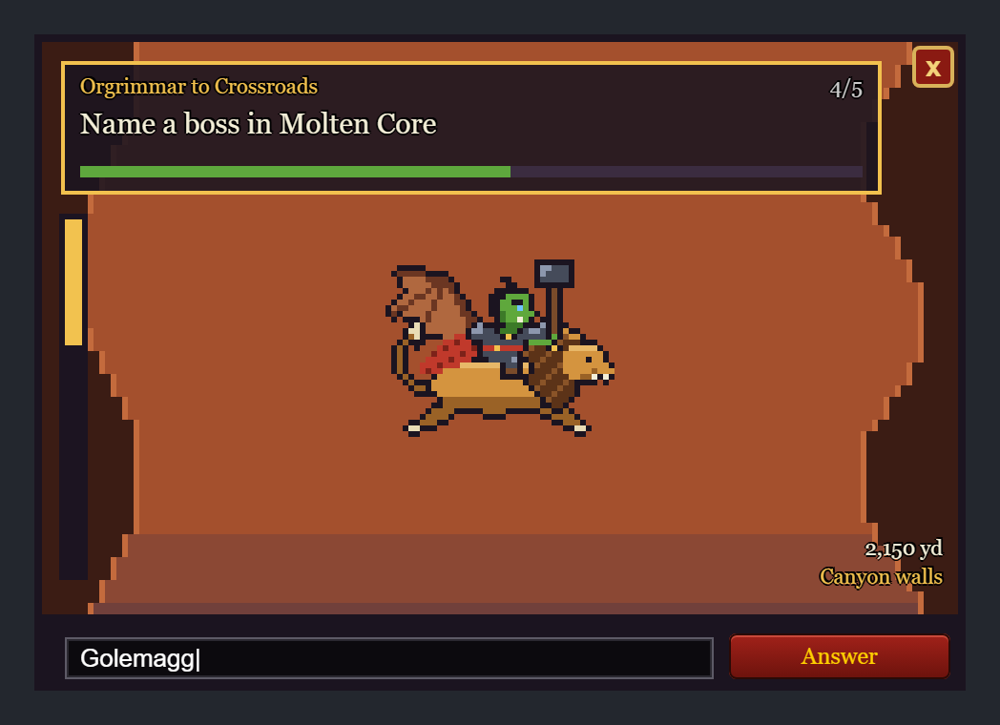
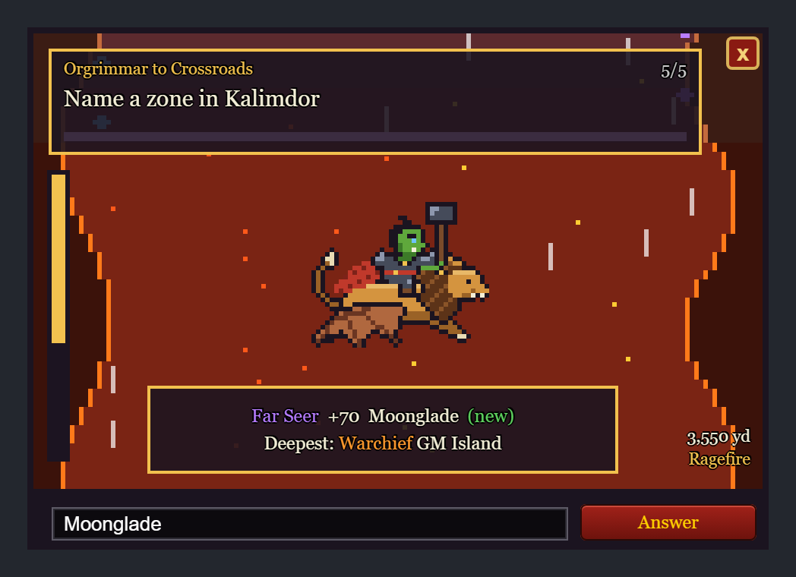
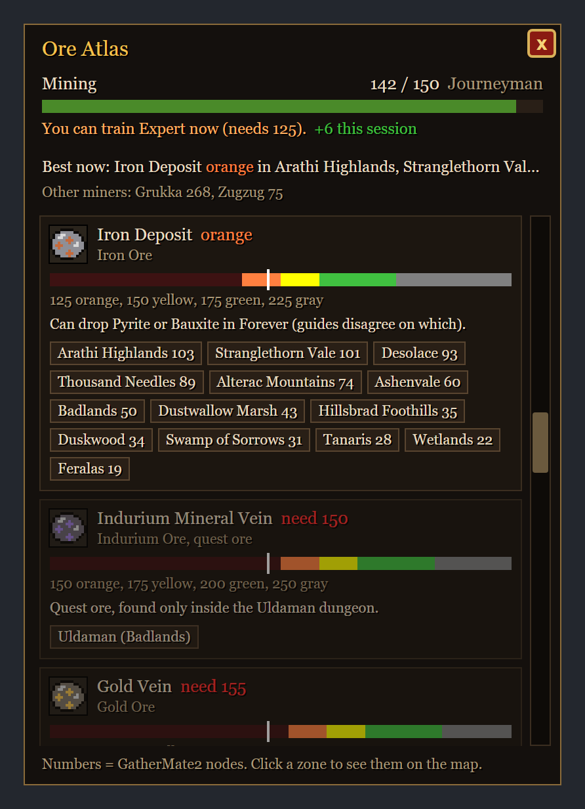

# WoW Forever Addons

Addons for World of Warcraft: Forever, Blizzard's level-60 original-Azeroth
mode on the modern client (interface 16001).

| Addon | What it does | Open with | Version |
| ----- | ------------ | --------- | ------- |
| [Wyvern Wits](addons/WyvernWits) | Reverse-trivia minigame on flight paths: rarer valid answers send an 8-bit Thrall diving deeper | `/wits`, or it opens on takeoff | 0.1.0 |
| [Ore Atlas](addons/OreAtlas) | Mining reference: every ore's skill colors, where to find it, ore areas on the world map, and your Mining progress | `/ore` | 0.2.0 |

Neither addon has been tested in game yet. If you hit a Lua error, turn on
`/console scriptErrors 1` and open an issue with the error text.

## Wyvern Wits

A reverse-trivia game that pops up when you take a flight path. Each prompt
("Name a boss in Molten Core") has a 20 second timer. Any valid answer
counts, but rarer ones score more. Every point drops Thrall on his wind
rider 10 yards deeper: through the clouds, over Durotar, down the canyons,
through Ragefire and the molten core.

<p>
  
  
</p>

_Preview rendered from the addon's own sprite, colors and layout. Real in-game screenshots will replace these once it's been tested._

- **Five tiers:** Peon 10, Grunt 25, Blademaster 45, Far Seer 70,
  Warchief 100.
- **No penalty for wrong guesses:** keep trying until the timer runs out.
  The reveal shows the rarest answer you could have given.
- **Fits the flight:** it times each route, fits the number of prompts to
  the flight, and keeps your best depth per route.
- **Forgiving answers:** short names like STV, BRD and Domo work, and a
  typo or two is forgiven.
- **20 prompts so far:** zones, dungeons, raid bosses, herbs, ores, orc and
  troll lore, dragons, factions, flight points, lore weapons and more.
- **Commands:** `/wits play` for a practice game without flying,
  `/wits auto on` to skip the Start button, `/wits stats` for your records.

[Full Wyvern Wits README](addons/WyvernWits/README.md)

## Ore Atlas

One scrollable pane with every ore you can mine, from Copper to Forever's
new Heavy Thorium.



_Preview rendered from the addon's own layout and data. Real in-game screenshots will replace these once it's been tested._

- **Live Mining skill:** the header shows your rank, trainer hints like
  "Capped at 150. Train Expert…", and skill-ups this session.
- **Best now:** the ore to mine at your skill and where to find it.
- **Ore cards:** each one has a color bar for its orange, yellow, green and
  gray ranges, with a marker at your skill, plus the exact thresholds.
- **Zone buttons:** each shows the zone's level range. Click one to open the
  world map there. Zones named by Forever guides are shown apart from classic
  spawn data.
- **Ore areas on the world map:** zones are shaded where ore spawns, in
  each ore's color for your skill, with a button on the map to turn it on
  or off. Node data comes from GatherMate2 if you have it installed (read
  from your own install, never copied), plus every spot you mine yourself.
- **"Useful for me" filter:** hides ores that are gray or too high for you.
- **Alts and alerts:** your other characters' Mining levels, and chat
  alerts when your best ore changes.
- **Commands:** `/ore` to open it, `/ore alerts off` to turn off alerts,
  `/ore debug` to check what the game reports.

[Full Ore Atlas README](addons/OreAtlas/README.md)

## Install

Copy an addon folder from `addons/` into
`World of Warcraft\_forever_\Interface\AddOns\`, so you end up with
`AddOns\OreAtlas\OreAtlas.toc` (for example). Then restart the game.

## Development

Requirements: Windows with PowerShell 7, and WoW Forever installed. Node.js
is only needed to rebuild pixel art. VS Code with the recommended extensions
(Lua + WoW API) gives autocomplete for the game API.

```powershell
git clone https://github.com/josephevenson08/wowforeveraddons.git
cd wowforeveraddons

# Create a new addon from the template and link it into the game
.\scripts\new-addon.ps1 -Name MyAddon -Title "My Addon" -Slash myaddon -Notes "What it does." -Link

# Link every addon in addons\ into the game (directory junctions)
.\scripts\link-addons.ps1

# Build release zips in dist\
.\scripts\package.ps1

# Rebuild sprite textures from the text pixel art in art\
node scripts/build-art.js art/flight-trivia addons/WyvernWits/media
```

The scripts assume the game is at `D:\World of Warcraft\_forever_`. For a
different path, pass `-WowPath` or write the path into
`scripts\wow-path.local.txt`.

After editing Lua, type `/reload` in game. New files or TOC changes need a
full restart. Turn on error popups with `/console scriptErrors 1`.

### Repo layout

```
addons/<Name>/            one folder per addon (folder name = TOC name), each with a README
templates/AddonTemplate/  starting point for new addons
art/                      text pixel-art sources for sprites
scripts/                  new-addon, link-addons, package, build-art
docs/                     Forever API notes and design docs
```

See [docs/forever-api-notes.md](docs/forever-api-notes.md) for what the
Forever API allows and blocks, and
[docs/flight-trivia-design.md](docs/flight-trivia-design.md) for the
Wyvern Wits design.
