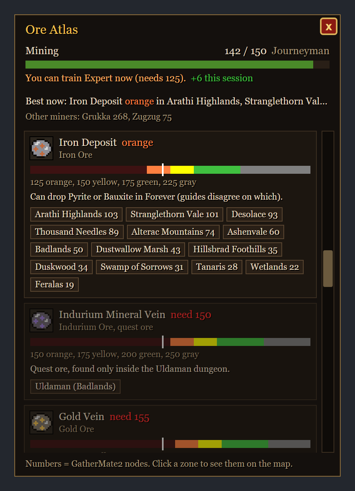

# Ore Atlas

A mining reference for WoW Forever. One scrollable pane lists every ore you
can mine. For each one it shows which color the ore is for you right now,
the skill where it turns yellow, green and gray, and the zones to find it
in. It can also shade where each ore spawns on the world map, and it
tracks your Mining skill.

Interface 16001 (WoW Forever). Version 0.2.0.

_The pane at Mining 142. This is a preview rendered from the addon's own layout and data. Real in-game screenshots will replace it once it's been tested._

## Install

Copy the `OreAtlas` folder into
`World of Warcraft\_forever_\Interface\AddOns\`, then restart the game.

For node areas in every zone, also install **GatherMate2** and
**GatherMate2_Data (Retail & Forever)** from CurseForge (their WoW Forever
files), then import the data once: type `/gathermate`, open **Import**, and
import Mining. Ore Atlas works without them, but then it only knows the spots
you've mined yourself.

## The pane

Open it with `/ore` or from the minimap addon menu.

- **Header:** your Mining skill and cap as a progress bar, your rank
  (Apprentice to Artisan), and any skill bonus from gear. Below that is a
  training hint, such as "Capped at 150. Train Expert at a Mining trainer
  to keep going.", plus your skill-ups this session.
- **Best now:** the ore to mine at your skill and its top three zones.
  Click it to scroll to that ore. It picks the highest common ore that's
  orange for you, then yellow, then green. Rare spawns and quest ores are
  never picked.
- **Other miners:** your other characters' Mining levels, saved whenever
  you log in on them.
- **Filter:** "All ores", or "Useful for me", which hides ores that are
  gray or too high for you.
- **Ore cards:**
  - The ore's icon, and its color for you, or "need 155" if your skill is
    too low.
  - A bar from 0 to 300 showing the orange, yellow, green and gray ranges,
    with a white marker at your skill.
  - The exact thresholds, for example "125 orange, 150 yellow, 175 green,
    225 gray".
  - Notes on special cases, like Ooze Covered versions or the Black Forge
    for Dark Iron.
  - An **On map / Off map** switch for the world map (see below).
  - Zone buttons. Click one to open the world map there (not in combat).
    Hover for details.

With node data (see below), zone buttons list the zones where that ore
really spawns, busiest first, with node counts like "Arathi Highlands 305".
Without node data, they fall back to the researched lists: gold zones are
named by WoW Forever mining guides, the rest come from classic spawn data,
and a `*` marks the densest zones in classic data.

## Ore areas on the world map

Open the world map on a zone and Ore Atlas shades the areas where ore
spawns. Each zone is cut into a 32 x 32 grid. Every square with nodes of an
ore you care about is filled in that ore's color for you: orange, yellow,
green or gray. The more nodes in a square, the stronger the shade. You get
general areas at a glance instead of hundreds of icons.

- **Which ores:** by default, the ores that still give you skill-ups
  (orange, yellow or green), plus Heavy Thorium and Obsidian. Use the
  **On map / Off map** switch on any ore card to pin it on or off.
  `/ore map auto` goes back to the default.
- **Map button:** the **Ore areas: on/off** button in the bottom-left
  corner of the world map turns shading on or off. Hover it to see which
  ores are drawn and how many nodes each has. Right-click it to open Ore
  Atlas.
- **Where the nodes come from:**
  - **GatherMate2**, if it's installed. Ore Atlas reads GatherMate2's
    Mining nodes from your own install while you play. It never copies or
    ships that data.
  - **Your own mining.** Every time you mine a node, Ore Atlas saves the
    spot. Over time this fills in zones on its own, with or without
    GatherMate2.
- Zone maps only. Continent and world maps aren't shaded.

## Ores

Colors follow the classic rule: orange at the required skill, yellow at
+25, green at +50, gray at +100.

| Node                      | Needs | Yellow | Green | Gray | Notes                              |
| ------------------------- | ----- | ------ | ----- | ---- | ---------------------------------- |
| Copper Vein               | 1     | 25     | 50    | 100  | Forever adds Poor Copper and Amber |
| Tin Vein                  | 65    | 90     | 115   | 165  |                                    |
| Incendicite Mineral Vein  | 65    | 90     | 115   | 165  | Quest ore, Wetlands                |
| Silver Vein               | 75    | 100    | 125   | 175  | Rare spawn                         |
| Lesser Bloodstone Deposit | 75    | 100    | 125   | 175  | Quest ore, Arathi                  |
| Iron Deposit              | 125   | 150    | 175   | 225  |                                    |
| Indurium Mineral Vein     | 150   | 175    | 200   | 250  | Quest ore, inside Uldaman          |
| Gold Vein                 | 155   | 180    | 205   | 255  | Rare spawn                         |
| Mithril Deposit           | 175   | 200    | 225   | 275  |                                    |
| Truesilver Deposit        | 230   | 255    | 280   | 330  | Rare spawn                         |
| Dark Iron Deposit         | 230   | 255    | 280   | 330  | Blackrock Mountain                 |
| Small Thorium Vein        | 245   | 270    | 295   | 345  |                                    |
| Rich Thorium Vein         | 275   | 300    | 325   | 375  |                                    |
| Heavy Thorium Vein        | 300   | -      | -     | -    | New in Forever, Mount Hyjal        |
| Obsidian Chunk            | 305   | -      | -     | -    | Ahn'Qiraj, needs +Mining gear      |

Trainer ranks: Apprentice to 75, Journeyman to 150 (train at 50), Expert to
225 (train at 125), Artisan to 300 (train at 200). Junior trainers in the
starting zones only teach up to 75.

## Commands

| Command                  | What it does                                         |
| ------------------------ | ---------------------------------------------------- |
| `/ore`                   | Open or close the pane                               |
| `/ore map [on\|off]`     | Ore areas on the world map (default on)              |
| `/ore map auto`          | Forget your per-ore map picks                        |
| `/ore alerts [on\|off]`  | Chat alerts when your best ore changes (default on)  |
| `/ore scale 0.9`         | Pane size, 0.5 to 2                                  |
| `/ore debug`             | Print Mining, map and node data the addon sees       |
| `/ore reset`             | Reset settings and pane position                     |
| `/ore help`              | List the commands                                    |

`/oreatlas` works too. Drag the pane to move it, and press Escape to close
it.

**Alerts:** when a skill-up changes your best ore, you get a chat message
like "Tin Vein is your best ore now (orange): Wetlands, Loch Modan,
Redridge Mountains." You also get one when you hit a trainer cap.

## How it works

- **Skill:** read with `GetProfessions` and `GetProfessionInfo`. The older
  skill functions are gone on Forever. No event fires for a single skill
  point, so the addon re-reads your skill whenever the "Your skill in
  Mining has increased" message appears, and when you learn a rank.
- **Maps:** zones are looked up by name in the game's live map data, since
  Forever may number zones differently from retail. Known retail map IDs
  are a fallback, used only when the name matches.
- **Ore data:** all of it is in [Data.lua](Data.lua), with sources listed
  at the top. The Forever client ships no spawn tables, so zone lists mix
  Forever guide reports with classic spawn data. If you find an ore
  somewhere the atlas doesn't list, or never find it where it says, fix
  `Data.lua`.

## Saved data

`OreAtlasDB` (account-wide) holds your filter, alert, scale and map
settings, the pane position, each character's Mining skill, and every spot
you've mined.

## Status

Not tested in game yet. On a first run:

- Run `/ore debug`. It shows the raw profession data Forever returns, any
  zones the map lookup couldn't find, whether GatherMate2 was found, and
  how many nodes it knows per ore.
- Open the world map on a zone with ore (Durotar, Arathi Highlands) and
  check that the shaded squares sit where the nodes are.
- If the header says "not learned" on a character that has Mining, the
  debug output shows why.
- Turn on `/console scriptErrors 1` to see any Lua errors.

## Files

| File        | Purpose                                                   |
| ----------- | --------------------------------------------------------- |
| `Core.lua`  | Saved settings, events, alerts, slash commands            |
| `Data.lua`  | Ores, zones, trainer ranks, skill colors                  |
| `Skill.lua` | Reads and saves your Mining skill                         |
| `Maps.lua`  | Finds a zone's map and opens the world map to it          |
| `Nodes.lua` | Node data: reads GatherMate2, records what you mine       |
| `MapOverlay.lua` | Shades ore areas on the world map, and the map button |
| `UI.lua`    | The pane: header, filter, ore cards, zone buttons         |
